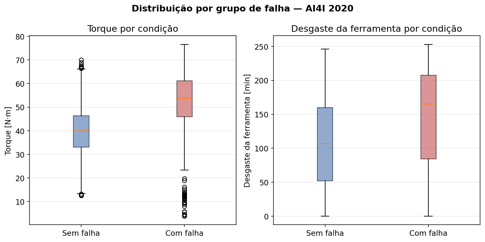
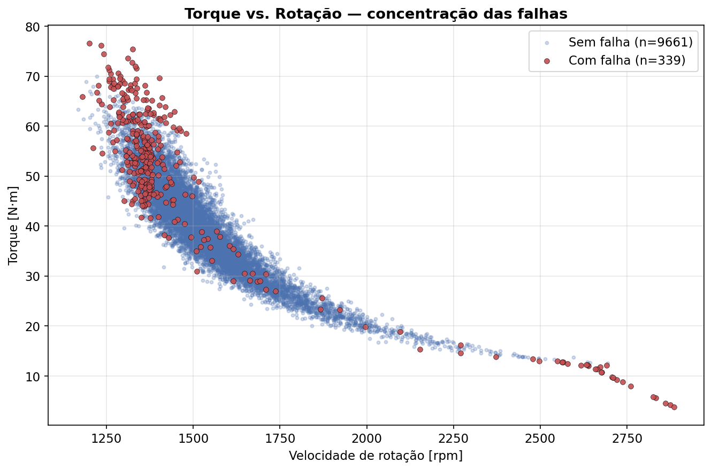
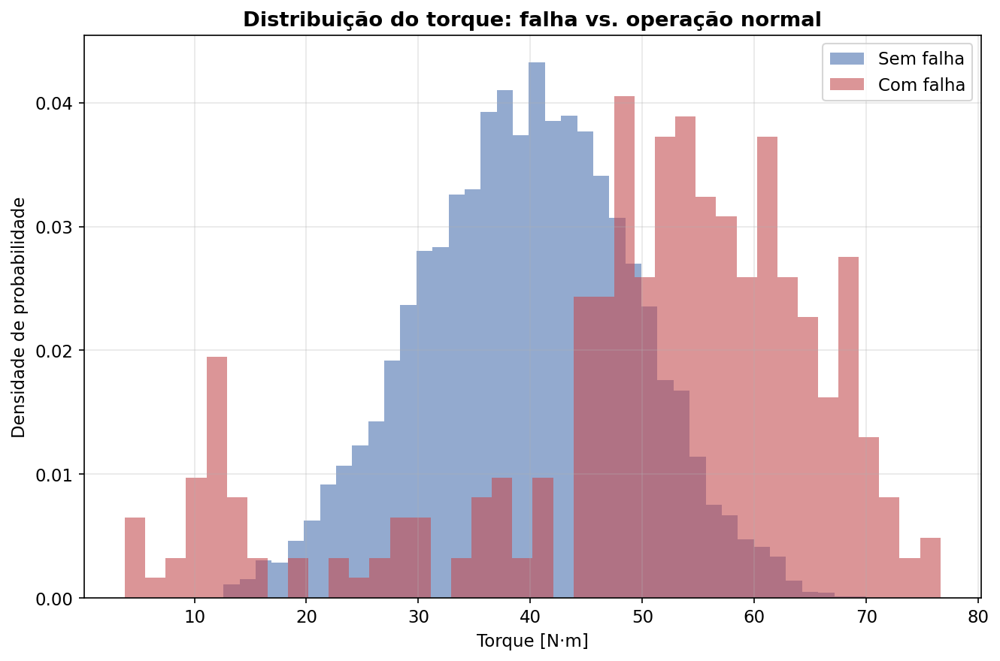
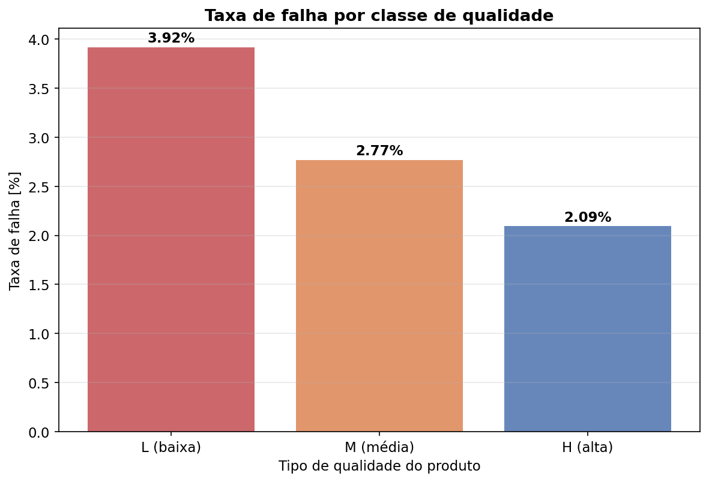
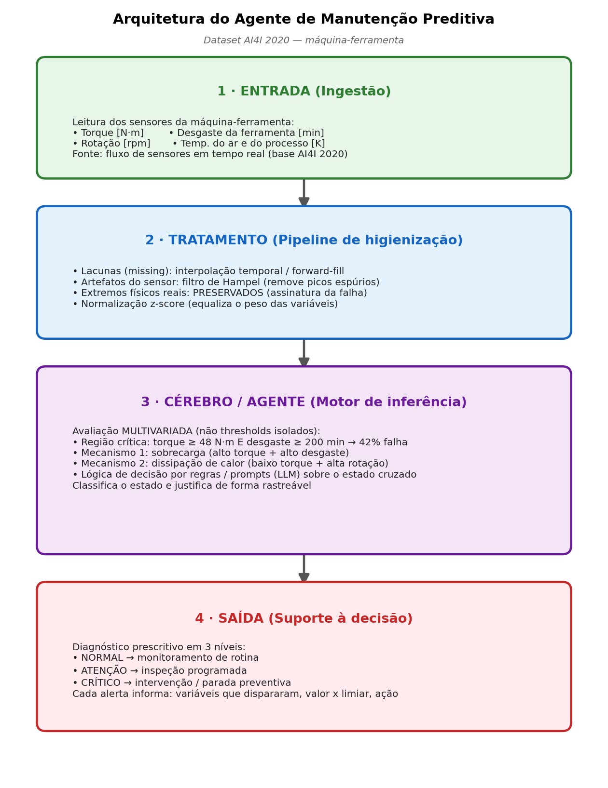
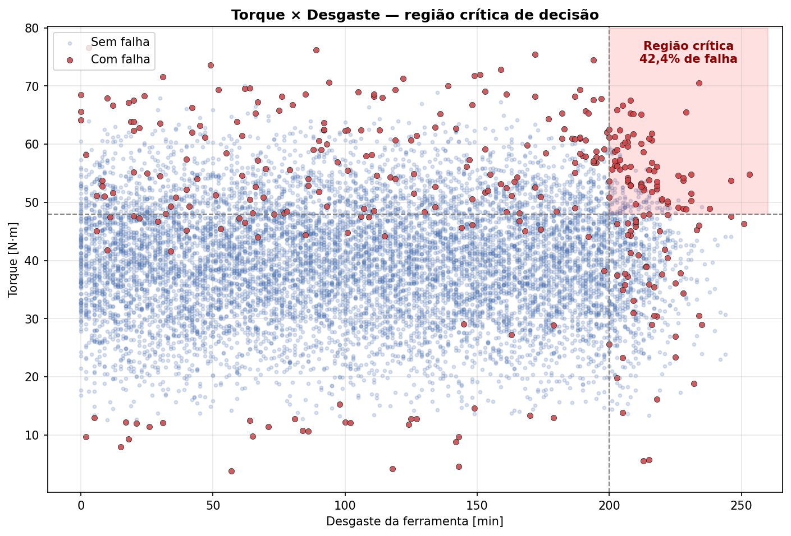
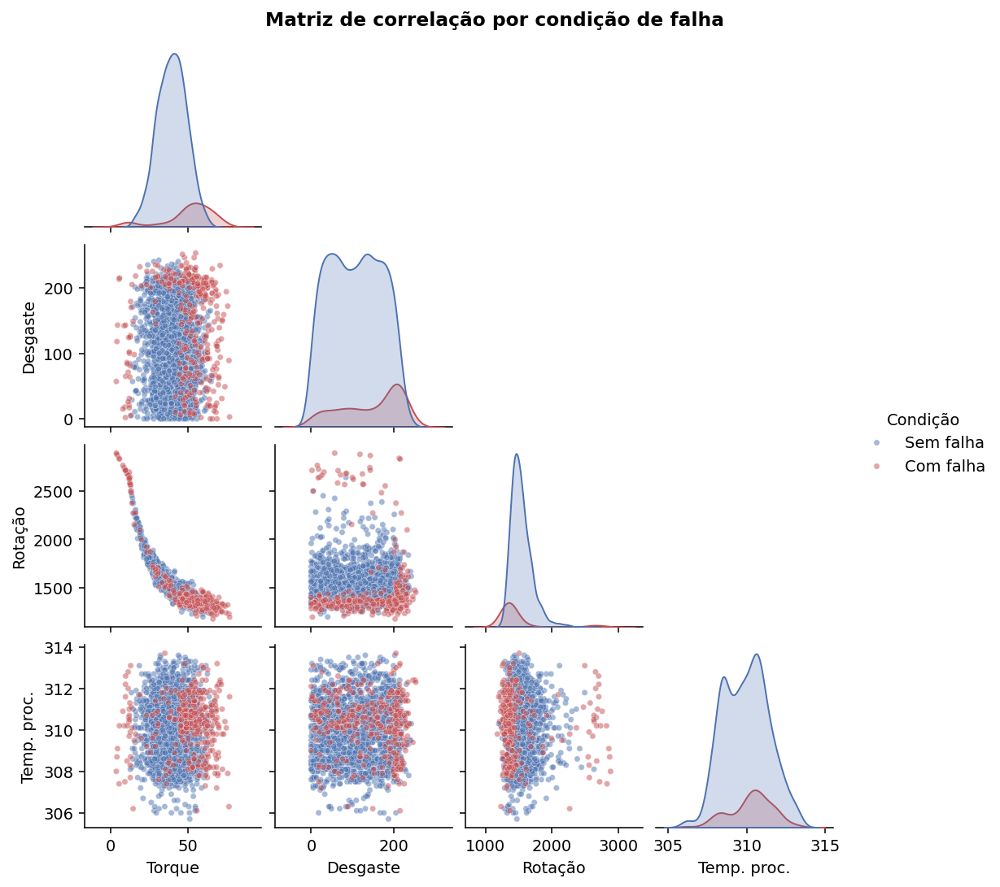

# Integração e Análise de Dados em Sistemas de Engenharia

Projeto desenvolvido na disciplina **Inteligência Artificial e Programação para Engenharia**. Série de experiências práticas que percorrem o ciclo completo de análise de dados aplicada à engenharia: da coleta de dados de sensores até um agente de diagnóstico de manutenção e um dashboard interativo.

## Objetivo
Selecionar, caracterizar, tratar e analisar uma base de medições de sensores voltada à **manutenção preditiva** (Indústria 4.0), culminando em um agente inteligente de diagnóstico, documentando cada decisão de forma reprodutível e auditável.

## Base de dados
- **AI4I 2020 Predictive Maintenance Dataset** — UCI Machine Learning Repository
- 10.000 registros, 14 variáveis, formato CSV (~510 KB)
- Licença Creative Commons CC BY 4.0
- Fonte: https://archive.ics.uci.edu/dataset/601/ai4i+2020+predictive+maintenance+dataset

## Variáveis de sensor
| Variável | Grandeza | Unidade |
|---|---|---|
| Air temperature | Térmica | K |
| Process temperature | Térmica | K |
| Rotational speed | Mecânica (rotação) | rpm |
| Torque | Mecânica (torque) | N·m |
| Tool wear | Desgaste (tempo) | min |

## EP I — Coleta, classificação e documentação
Seleção da base, dicionário de variáveis (metadados) e classificação física dos sensores.

**Resumo estatístico (10.000 registros):**

| Variável | Mín | Máx | Média | Desvio |
|---|---|---|---|---|
| Air temperature [K] | 295,30 | 304,50 | 300,00 | 2,00 |
| Process temperature [K] | 305,70 | 313,80 | 310,01 | 1,48 |
| Rotational speed [rpm] | 1168 | 2886 | 1538,78 | 179,28 |
| Torque [Nm] | 3,80 | 76,60 | 39,99 | 9,97 |
| Tool wear [min] | 0 | 253 | 107,95 | 63,65 |

**Tratamento e integridade:** verificação com `df.isnull().sum()` e `df.duplicated()` — nenhum nulo e nenhuma duplicata. Outliers avaliados por IQR (1,5×): rotação (418 pontos) e torque (69 pontos) foram **mantidos**, por representarem as condições extremas em que as falhas ocorrem.

Script: `analise_ai4i.py`.

## EP II — Análise, tratamento e visualização
**Tratamento (Pandas/NumPy):** padronização de cabeçalhos para snake_case, conversão de `Type` para `category`, confirmação da integridade (base preservada, sem `dropna`/`fillna`) e criação de variáveis derivadas (diferença térmica e potência mecânica).

**Análise exploratória (groupby por condição de falha):**

| Variável | Sem falha | Com falha |
|---|---|---|
| Torque [N·m] | 39,63 | 50,17 |
| Desgaste [min] | 106,69 | 143,78 |
| Potência [W] | 6245 | 7283 |

Taxa de falha global: **3,39%**. Por qualidade: L 3,92% · M 2,77% · H 2,09%.

**Principais descobertas:** torque e desgaste são os discriminadores mais fortes da falha; a falha é um fenômeno combinado (torque × rotação próximo do limite de potência de 9000 W); a qualidade do produto modula o risco. Os outliers foram preservados por representarem o próprio sinal da falha.

Script: `ep2_analise_ai4i.py`.

### Visualizações

## EP III — Agente inteligente de diagnóstico
Projeto de um agente de manutenção preditiva baseado em LLM, com arquitetura em quatro camadas (ingestão → tratamento → inferência → saída).

**Limiares de decisão (derivados dos dados):** a análise identificou uma região crítica combinada — torque ≥ 48 N·m **e** desgaste ≥ 200 min — com **42,4% de falha**, contra 3,39% da base geral (~12× o risco médio). O agente avalia as variáveis de forma cruzada, superando limites estáticos isolados, e classifica o estado em três níveis (NORMAL / ATENÇÃO / CRÍTICO) com recomendação prescritiva.

O system prompt do agente está em `system_prompt_agente.md`.

### Arquitetura e análise de decisão

## Tecnologias
Python 3 · Pandas · NumPy · Matplotlib · Seaborn

## Status do projeto
- [x] EP I — Coleta, classificação e documentação
- [x] EP II — Análise, tratamento e visualização
- [x] EP III — Agente inteligente de diagnóstico de manutenção
- [ ] EP IV — Dashboard interativo

---
Base de dados: Matzka, S. (2020). *AI4I 2020 Predictive Maintenance Dataset*. UCI Machine Learning Repository. Licença CC BY 4.0.
